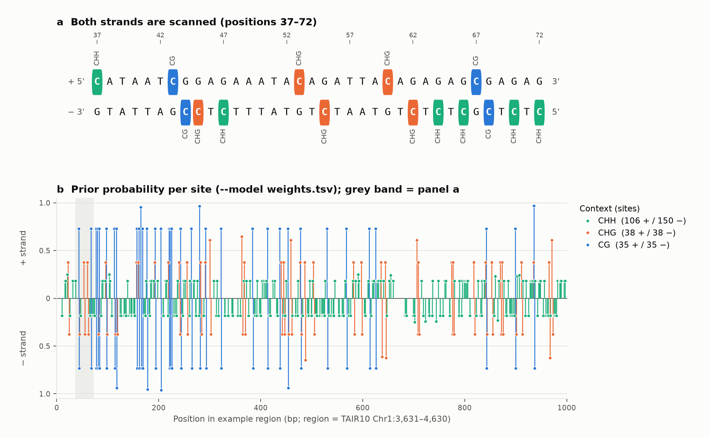

# Revelio 🪄 — Lightweight Methylation-Context Predictor

<table>
  <tr>
    <td width="260" valign="top" style="padding-right:16px;">
      
    </td>
    <td valign="top">
      <strong>Revelio</strong> (HP charm for revealing hidden things) quickly scans
      FASTA/FASTQ to identify cytosine contexts <strong>CG / CHG / CHH</strong> and assigns a
      <strong>sequence-based prior probability</strong> to each candidate site (either a simple
      heuristic or a user-provided logistic <strong>k-mer</strong> weight table). It’s designed for
      <strong>fast triage</strong> and <strong>candidate region ranking</strong> before heavier
      signal-level methylation callers.
      <br><br>
      <blockquote>⚠️ Revelio uses <strong>sequence context only</strong> (no raw signal). For
      signal-level calling on ONT data, use tools such as Remora/Dorado, Megalodon, or DeepSignal-plant.</blockquote>
    </td>
  </tr>
</table>


[](https://github.com/yykaya/Revelio/actions/workflows/ci.yml)

**Status:** research prototype (v0.3.0) • **Developer:** Yasin Kaya, MPIPZ (ykaya@mpipz.mpg.de | yyasinkkaya@gmail.com) • **License:** MIT

---

## Features

- **Fast, portable, single binary.** Streams large genomes/reads in one pass.
- **Both strands.** Reports cytosines on the + and − strand (`--strand both|+|-`).
- **Window profiles.** `--window`/`--step` summarise a genome or locus into chunks: context counts per strand, GC, CpG o/e and mean prior per window.
- **Context-aware priors.** Pick a quick **heuristic** or supply your own **logistic k-mer weights** with per-context intercepts.
- **FASTA/FASTQ auto-detection.** Handles multi-line FASTA and 4-line FASTQ.
- **Practical TSV output**: `seq_id, pos_1based, context, strand, kmer, prob`.
- **Works from stdin.** Pipe compressed input via `zcat`/`pigz -dc` (`-i -` or `-i /dev/stdin`).

---

## Build

### Prerequisites
- A C++17 compiler (GCC ≥ 8, Clang ≥ 7, or MSVC ≥ 2019).

### Linux / macOS
```bash
g++ -std=c++17 -O3 -march=native -o revelio revelio.cpp
# or
clang++ -std=c++17 -O3 -march=native -o revelio revelio.cpp
```

### Windows (MSVC x64 Native Tools)
```bat
cl /std:c++17 /O2 /EHsc revelio.cpp /Fe:revelio.exe
```

### Optional: Makefile
Drop this into a file named `Makefile`:
```make
CXX ?= g++
CXXFLAGS ?= -std=c++17 -O3 -march=native -Wall -Wextra -DNDEBUG

revelio: revelio.cpp
	$(CXX) $(CXXFLAGS) -o $@ $<

clean:
	rm -f revelio
```

---

## Quick Start

Heuristic priors (no model):
```bash
./revelio -i genome.fa --heuristic > calls.tsv
```

FASTQ with a logistic weights table and 7-mer context:
```bash
./revelio -i reads.fq --model weights.tsv -k 7 --header --out calls.tsv
```

Filter by context (only CG and CHG):
```bash
./revelio -i genome.fa --heuristic --contexts CG,CHG > calls.tsv
```

Stream a gzipped FASTA:
```bash
zcat genome.fa.gz | ./revelio -i - --heuristic > calls.tsv
```

---

## Example

[`examples/col0_chr1_3631-4630.fa`](examples/) is 1 kb of the *Arabidopsis thaliana* Col-0 reference (TAIR10 Chr1:3,631–4,630, the 5' end of AT1G01010 / NAC001). Run it with the starter weights:

```bash
./revelio -i examples/col0_chr1_3631-4630.fa --model weights.tsv --header \
    -o examples/col0_chr1_3631-4630.model.tsv
python3 docs/make_example_figure.py   # redraws docs/example_sites.png (needs matplotlib >= 3.6)
```



**a.** A 36-bp stretch of the region. Revelio reads the top strand 5'→3' and the bottom strand 5'→3' as well (right to left here). Each highlighted base is a cytosine that Revelio reports, coloured by context. A CG is symmetric, so its C sits on both strands (positions 43/44 and 67/68). CHG and CHH sites are strand-specific. The CAG at 53 and the CTG at 55 are mirror images of each other.

**b.** Every reported site in the 1-kb region. + strand sites point up and − strand sites point down, and the stem height is the prior probability. The bundled `weights.tsv` is illustrative, so most k-mers are not in the table and score the intercept of their context (`BIAS_CG` ≈ 0.73, `BIAS_CHG` ≈ 0.38, `BIAS_CHH` ≈ 0.18). The few k-mers that are in the table stand out above that level. The region has 402 sites, 223 of them on the − strand, all of which a forward-only scan would miss. Coordinates in `seq_id` = `Chr1:3631-4630` are relative to the region (position 1 = Chr1:3,631).

---

## Usage
```text
revelio 0.3.0 — lightweight methylation context predictor
Usage:
  revelio -i <input.fa|fq|-> [--fasta|--fastq] [-k 5]
          [--heuristic | --model weights.tsv]
          [--contexts CG,CHG,CHH] [--strand both] [--header] [--out output.tsv]

Options:
  -i, --input <path>      Input FASTA/FASTQ; '-' or /dev/stdin reads stdin
      --fasta             Force FASTA (auto-detected by default)
      --fastq             Force FASTQ
  -k, --kmer <odd>        Centered k-mer size (default: 5; odd, >= 3)
      --heuristic         Use built-in heuristic priors (no weights table)
      --model <tsv>       Use logistic weights table
      --contexts <list>   Comma-separated subset (CG,CHG,CHH); default: all
      --strand <s>        both | + | - (default: both)
      --window <bp>       Write one profile row per window instead of one row per site
      --step <bp>         Window step (default: --window; --window must be a multiple)
      --header            Print header line in TSV output
  -o, --out <path>        Write to file (default: stdout)
  -h, --help              Show help and exit
      --version           Show version and exit
```

**Output columns (TSV)**  
`seq_id  pos_1based  context  strand  kmer  prob`  
`seq_id` is the header text up to the first whitespace. Invalid options or inputs exit with a non-zero status.

Example (from [`examples/`](examples/)):
```text
Chr1:3631-4630  43      CG      +       ATCGG   0.731059
Chr1:3631-4630  44      CG      -       TCCGA   0.731059
Chr1:3631-4630  118     CG      -       ACCGT   0.937027
```

> Note: a minus-strand site is reported at the + strand coordinate of its **G** (the C on the reverse strand), and its `kmer` and context are read 5'→3' on the minus strand. A CG dinucleotide therefore gives two rows (C at `pos`, `+`; G at `pos+1`, `-`). Use `--strand +` for the v0.1 forward-only behaviour.

---

## Window profiles (`--window`)

For a quick, alignment-free scan of a genome or locus, `--window <bp>` writes one row per window instead of one row per site. `--step <bp>` makes windows overlap (`--window` must be a multiple of `--step`). The usual `--contexts`, `--strand`, `-k` and `--heuristic`/`--model` options apply. The site counts always equal the per-site rows of the same command.

```bash
./revelio -i examples/col0_chr1_3631-4630.fa --model weights.tsv --window 200 --header
```

```text
seq_id          start  end   n_acgt  gc      cpg_oe  CG_plus  CG_minus  CHG_plus  CHG_minus  CHH_plus  CHH_minus  p_CG      p_CHG     p_CHH
Chr1:3631-4630  0      200   200     0.4350  1.5135  14       14        7         8          16        28         0.754237  0.377541  0.185485
Chr1:3631-4630  200    400   200     0.4000  1.2788  10       10        8         6          16        30         0.754216  0.413342  0.182426
Chr1:3631-4630  400    600   200     0.4450  0.6494  6        6         8         9          19        41         0.748223  0.407024  0.183547
Chr1:3631-4630  600    800   200     0.3100  0.4167  2        2         6         6          22        24         0.731059  0.436800  0.187676
Chr1:3631-4630  800    1000  200     0.4200  0.3419  3        3         9         9          33        27         0.770500  0.404097  0.185846
```

| Column | Description |
|---|---|
| `start`, `end` | window, BED convention (0-based, half-open); the last window of a sequence can be shorter |
| `n_acgt`, `gc` | called (non-N) bases and their GC fraction |
| `cpg_oe` | CpG observed/expected = n(CG)·n_acgt / (n(C)·n(G)) (Gardiner-Garden & Frommer 1987); `NA` without C or G |
| `CG_plus` … `CHH_minus` | site counts per context and strand |
| `p_CG`, `p_CHG`, `p_CHH` | mean prior per context; `NA` when the window has no such site |

CpG o/e is a sequence-level footprint of methylation history: methylated CpGs mutate to TpG through deamination, so long-term CG methylation depletes CpG. In the example, o/e is high at the 5' end of AT1G01010 (CpG-rich promoter/TSS) and drops to ~0.34 further into the region. Like the per-site priors, it describes the sequence and not the methylation state of a sample.

---

## Modes

### Heuristic mode (`--heuristic`)
A fixed prior per **context class** that follows the usual plant ordering: CG 0.85, CHG 0.55, CHH 0.25. The k-mer is not used. Intended for **fast ranking**, not calibrated probabilities.

### Logistic weights mode (`--model weights.tsv`)
Loads a user-provided **(context, k-mer) → weight** mapping and computes:
```
p = sigmoid( BIAS + BIAS_<context> + weight(context, kmer) )
sigmoid(x) = 1 / (1 + e^(-x))
```
- `-k` must be **odd** (e.g., 5, 7, 9) and the k-mer is centered on the cytosine.
- Missing terms count as 0: a `(context,kmer)` pair absent from the table scores `sigmoid(BIAS + BIAS_<context>)` (0.5 when neither row is given).
- Minus-strand sites are looked up with their minus-strand k-mer, so one table serves both strands.
- The table is validated on load: unknown contexts, non-ACGT k-mers, mixed k-mer lengths, or a k-mer length different from `-k` are errors.
- `--heuristic` and `--model` are mutually exclusive; an unreadable `--model` is an error (no silent fallback).

---

## Weights Table Format

A simple **TSV without header**:

```text
# optional global bias row
BIAS      0.0

# optional per-context intercepts
BIAS_CG   1.0
BIAS_CHG  -0.5
BIAS_CHH  -1.5

# context  kmer       weight
CG       AACGT       2.25
CHG      TTCAG       1.10
CHH      TACCA       0.30
```

Guidelines:
- `context ∈ {CG, CHG, CHH}`
- `kmer` length must equal `-k`, be DNA (A/C/G/T), and have the cytosine in the middle.
- Use **`BIAS`** to shift all logits up/down (a global intercept).
- Use **`BIAS_CG` / `BIAS_CHG` / `BIAS_CHH`** to give each context its own intercept, so unlisted k-mers keep the expected CG > CHG > CHH ordering. These rows need Revelio ≥ 0.2.0: older versions silently read them as the global `BIAS` (see [CHANGELOG](CHANGELOG.md)).
- The bundled [`weights.tsv`](weights.tsv) holds **illustrative** values for k = 5, not weights trained on methylation data.

---

## Input Notes

- **FASTA**: multi-line sequences supported; Windows (CRLF) line endings are handled.
- **FASTQ**: 4-line records, qualities ignored (sequence only).
- **Compression**: not handled internally—use shell pipes (`zcat | revelio -i /dev/stdin`).

---

## Output Schema (TSV)

| Column       | Description                                        |
|--------------|----------------------------------------------------|
| `seq_id`     | FASTA/FASTQ record identifier                      |
| `pos_1based` | 1-based + strand coordinate of the cytosine (for `-` sites, the G on the + strand) |
| `context`    | One of `CG`, `CHG`, `CHH`                          |
| `strand`     | `+` or `-` (strand of the cytosine)                |
| `kmer`       | Centered k-mer read 5'→3' on the C's strand (odd `-k`, C is the center) |
| `prob`       | Heuristic/logistic probability in **[0,1]**        |

---

## Performance Tips

- Compile with `-O3 -march=native` on a recent compiler.
- Prefer smaller odd `-k` (5 or 7) for speed; larger `k` can improve specificity but increases table size and cache pressure.
- Stream from disk or stdin. Records are processed one at a time, so peak memory is about the size of the largest sequence (e.g. one chromosome).

---

## How Revelio fits in your pipeline

- Use Revelio to **pre-rank** CG/CHG/CHH sites or **flag hotspots** before signal-level callers.
- For **ground-truth methylation** on ONT data, switch to **Remora/Dorado**, **Megalodon**, or **DeepSignal-plant** and then reconcile with Revelio’s ranked candidates.

---

## Roadmap

- Duplex-aware reporting (merge the two C's of a CG into one row)
- Optional BED/BEDMethyl output
- Native gzip input
- Pluggable k-mer featurizers (e.g., degeneracy, repeats)

---

## License

MIT. See [https://github.com/yykaya/Revelio/blob/main/LICENSE](LICENSE).

---

## Acknowledgements

Thanks to the plant epigenetics community for foundational work on CG/CHG/CHH methylation and to the ONT ecosystem for practical modified-base pipelines that complement Revelio.
